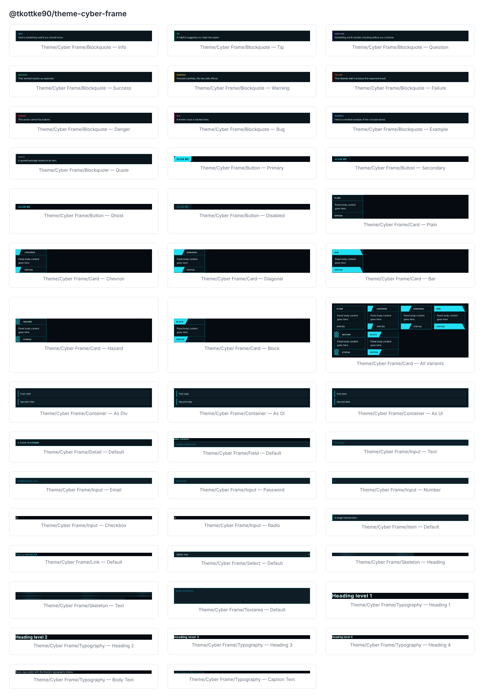

# @tkottke90/theme-cyber-frame

Dark, angular sci-fi HUD theme (Tailwind v4-based), built to a single
self-contained stylesheet. Inspired by a holographic container-frame
mockup: cyan accents on a near-black background, sharp/clipped corners
instead of rounded ones, and a `Card` component with six header/footer
frame variants (`plain`, `chevron`, `diagonal`, `bar`, `hazard`, `block`).



## Usage

```
npm install @tkottke90/theme-cyber-frame
```

```js
import "@tkottke90/theme-cyber-frame";
```

or link `dist/index.css` directly in an HTML `<link>` tag.

## Local development

```
npm run build              # compiles src/index.css -> dist/index.css
npm run storybook          # preview the theme's component classes
```
