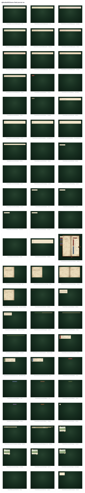

# @tkottke90/theme-field-journal-wc

A fantasy/medieval "leather-bound explorer's field journal" component theme,
built as framework-agnostic Web Components with [Lit](https://lit.dev). A
leather book cover with colored navigation tabs, parchment pages with a
ruled double frame and corner flourishes, and hand-placed content (ribbon
headings, quest cards with colored pennants, taped sketches, handwritten
notes) on top of the repo's baseline component set. Warm and muted
throughout — no glossy or neon colors, no thick cartoon outlines; texture
comes from hairline rules, warm shadows and SVG-filter grain.



> The screenshot is generated: run `npm run screenshot` after
> `npm run build-storybook`. The `Demo` story comes first, then each
> component's intro and its stories.

## Demo

The **Demo** story (`Theme/Field Journal WC/Demo` in Storybook) is a full,
interactive page built from the package's components: a six-section book
(Quests, Places, People, Creatures, Notes, Collection) with real tab
switching, and a working form on the first tab that submits and resets. It
replaces the old `demo/index.html`, so there's one demo to keep up to date
and it appears in Storybook and the screenshot.

```
npm run storybook
```

The screenshot shows the first tab; click through the others in Storybook to
see the rest of the set.

## Usage

```
npm install @tkottke90/theme-field-journal-wc lit
```

```js
import "@tkottke90/theme-field-journal-wc";
```

This theme's fonts (IM Fell English / IM Fell English SC, EB Garamond,
Caveat) load from Google Fonts — add these tags to your page's `<head>`
(Storybook loads the same tags for its own preview, via
`.storybook/preview-head.html`):

```html
<link rel="preconnect" href="https://fonts.googleapis.com" />
<link rel="preconnect" href="https://fonts.gstatic.com" crossorigin />
<link
  href="https://fonts.googleapis.com/css2?family=IM+Fell+English:ital@0;1&family=IM+Fell+English+SC&family=EB+Garamond:wght@400;500;600&family=Caveat:wght@500&display=swap"
  rel="stylesheet"
/>
```

Without them, every component still renders — font-family falls back to
Georgia/serif/cursive, just without the period look.

```html
<theme-journal-book id="book" selected="quests">
  <theme-journal-page slot="left" side="left">
    <theme-heading level="1" style="text-align: center; display: block;"
      >Field Journal</theme-heading
    >
    <theme-divider></theme-divider>
  </theme-journal-page>

  <theme-journal-page slot="right" side="right">
    <theme-ribbon>Active Quests</theme-ribbon>
    <theme-progress label="Overall progress" value="42"></theme-progress>
    <theme-quest-card
      heading="The Lost Parcel"
      location="Lakeside Village"
      description="A villager's parcel went missing on its way to the far dock."
      color="red"
      icon="parcel"
    ></theme-quest-card>
  </theme-journal-page>
</theme-journal-book>

<script type="module">
  const book = document.getElementById("book");
  book.tabs = [
    { id: "quests", label: "Quests", color: "red", icon: "quest" },
    { id: "places", label: "Places", color: "blue", icon: "pin" },
  ];
</script>
```

`lit` is a peer dependency so every theme package in this repo shares a
single copy of it.

To style your own elements with the theme's colours and fonts, load the design
tokens on your page:

```js
import "@tkottke90/theme-field-journal-wc/tokens.css";
```

**For AI agents and anyone extending the theme:** [`AGENTS.md`](./AGENTS.md)
(shipped with the package) has the style guide and usage for vanilla and
Preact projects.

The components are designed to sit on the green table (`--color-bg`). See
Storybook for every component and its stories.

## Components

`theme-button`, `theme-input`, `theme-textarea`, `theme-select`,
`theme-card`, `theme-heading`, `theme-text`, `theme-link`, `theme-container`,
`theme-item`, `theme-field`, `theme-detail`, `theme-blockquote` (10 types),
`theme-skeleton-heading`, and `theme-skeleton-text`, plus the signature
components below.

### Extras

Beyond the baseline set, this theme adds the book itself:

| Component            | What it is                                                                                                            |
| -------------------- | --------------------------------------------------------------------------------------------------------------------- |
| `theme-journal-page` | A parchment page: stacked paper edges, grain/stains, vignette, gutter shadow, a double ruled frame, corner flourishes |
| `theme-journal-book` | The leather cover: two slotted pages (`slot="left"`/`slot="right"`), colored nav tabs, bookmark ribbon                |
| `theme-ribbon`       | A notched cloth banner heading, one of six category colors                                                            |
| `theme-quest-card`   | A cream card with a colored pennant strip, title/status-tag/favorite, location, description + task list               |
| `theme-progress`     | A pressed-in parchment track with a grainy green fill                                                                 |
| `theme-taped`        | A taped-in sketch/photo: tape corners, slight tilt, handwritten caption                                               |
| `theme-notes`        | A cream card with ruled lines for handwritten margin notes                                                            |
| `theme-divider`      | An ornamental divider for under page titles / between sections                                                        |

`theme-journal-page`'s inner content padding is themeable: it reads
`--page-padding` (default `68px 66px 74px`, set in
`themes/field-journal/theme.css`, sized to clear the corner flourishes with
real breathing room). Override it per-instance — any 1-4 value `padding`
shorthand works — for a lighter or heavier margin:

```html
<theme-journal-page style="--page-padding: 48px 46px 54px;">…</theme-journal-page>
```

`theme-journal-book`'s tabs, `theme-ribbon` and `theme-quest-card`'s pennant
all take the same `color` enum — `"red" | "blue" | "tan" | "green" |
"purple" | "orange"` — one per section (Quests/Places/People/Creatures/
Notes/Collection in the reference). Give each section one color and use it
everywhere that section appears.

### Forms

`theme-input`, `theme-select` and `theme-textarea` are form-associated custom
elements: inside a `<form>` they submit under their `name`, reset with the
form, follow `<fieldset disabled>`, and fire `change` from the host. They're
labelable, so both `<label for="id">` and a wrapping `<label>` work, including
toggling a checkbox or radio by clicking the label text. Radios with the same
`name` form a group.

Each control passes its accessible name to the native element inside it, so
screen readers announce the label: from `aria-label` on the element, or from
its `<label>`. `theme-field` names the control it wraps with its own label
(unless the control already has a name) and focuses it when the label is
clicked. Wrapping radios, it labels their group instead: put the radios in an
element (a `<div>`) and the field names that element as a `radiogroup`, so
each radio keeps its own label.

```html
<form>
  <theme-field label="Email">
    <theme-input name="email" type="email"></theme-input>
  </theme-field>
  <label><theme-input type="checkbox" name="news" value="yes"></theme-input> Newsletter</label>
  <theme-select name="plan" aria-label="Plan"
    ><option>Starter</option>
    <option>Team</option></theme-select
  >
</form>
```

**Migrating:** the form controls no longer read an `accessible-label`
attribute; use `aria-label` instead. `theme-button` keeps `accessible-label`
for now.

This behaviour comes from the shared `FormControlElement` and `FieldElement`
base classes (see `docs/adr/0002-shared-wc-core.md`).

## Where Tailwind stops

Component styling in this repo is normally authored with Tailwind utility
classes against the theme's shared `themes/<name>/theme.css` tokens (see
`docs/adr/0001-theme-token-architecture.md`). This theme's skeuomorphic
chrome — the leather gradients, grain textures, ribbon/pennant notches
(`clip-path`), and the page's SVG filters — has no Tailwind utility
equivalent, the same reasoning `@tkottke90/theme-tactical-wc` already
applies to its HUD frame SVGs. That CSS is hand-written (still only
`var(--…)` references into `themes/field-journal/theme.css` — no hex values
live in a component file) inside each component's own `static styles`,
alongside Tailwind classes for the parts Tailwind does express well
(padding, flex/grid layout, font selection, simple colors).

Every filter/gradient a component needs is defined inline in that
component's own shadow root (see `journal-defs-svg.ts`), rather than once in
a page-level `<svg>`: Shadow DOM scopes element IDs, so a filter declared in
one shadow root can't be reached via `url(#id)` from another — the same
constraint `theme-tactical-wc`'s `hud-frame-svg.ts` documents for its own
glow filter. Duplicating these tiny, static filters per instance is cheap.

## Accessibility

Contrast was measured from the resolved tokens, on the surface each ink sits
on (see Rule 10 in [`AGENTS.md`](./AGENTS.md) for the full table). Body text
(9.8:1 on a card), links, the primary button and placeholders all meet AA.

**Known failures, not claimed as AA:**

- Tab and ribbon labels measure 3.5–4.3:1 at the lighter end of their
  gradient. The darkened `--tan-dark`, `--orange-dark` and `--green-dark`
  fix those swatches on a flat fill (5.2–5.5:1) but not under the gradient.
- Blockquote type labels: only `success` and `failure` pass; `bug` (2.3:1)
  and `example` (2.7:1) are the lowest. Body text in every blockquote passes.
- No Windows High Contrast fallback (`@media (forced-colors: active)`).
- `theme-journal-book`'s tabs are plain `<button>`s with `aria-current`,
  not a full ARIA tab pattern (`role="tablist"`, arrow-key navigation).

Every control is announced with its label (checked in a Chromium
accessibility snapshot), and `theme-progress` is named from its `label`.

## Local development

```
npm run generate         # src/generated/: compiled theme styles + shared WC base classes
npm run build            # esbuild -> dist/{index.mjs,index.cjs,*.d.ts,tokens.css}
npm test                 # jest + jsdom
npm run storybook        # preview components
npm run build-storybook  # static Storybook, used by the screenshot
npm run screenshot       # regenerate docs/screenshot.png
```

Tokens live in `themes/field-journal/theme.css`; component styles are
compiled from them, never hand-copied.
