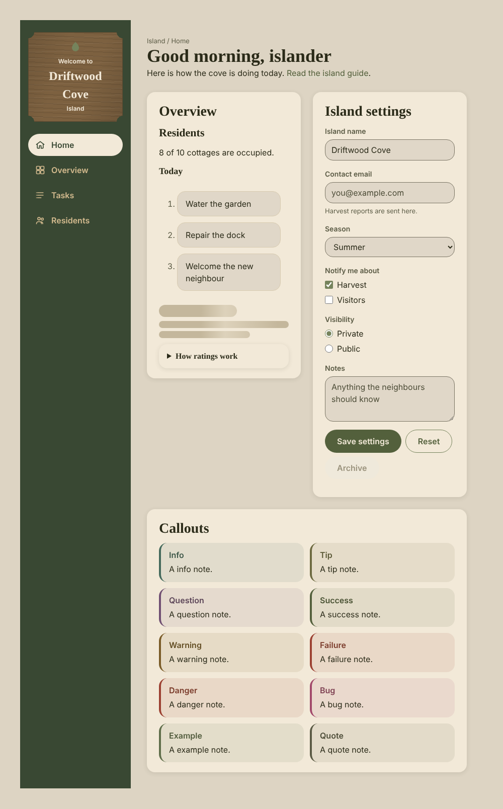

# @tkottke90/theme-forest-isle

A warm, illustrated cozy-life-sim dashboard theme: a sage-green brand
colour, parchment surfaces on a darker sand page, a serif heading and sans
body pairing, fully rounded shapes, and a dark forest-green sidebar with a
wood-grain sign. It is CSS only: one stylesheet of hand-written classes
(`.theme-button`, `.theme-card`, `.theme-input`, …) authored with Tailwind
v4's CSS-first `@theme` directive. No JavaScript ships.



## Usage

```
npm install @tkottke90/theme-forest-isle
```

With a bundler (Vite, esbuild, webpack, …):

```js
import "@tkottke90/theme-forest-isle";
```

Without one, link the built file:

```html
<link rel="stylesheet" href="node_modules/@tkottke90/theme-forest-isle/dist/index.css" />
```

Then use the classes on ordinary HTML:

```html
<div class="theme-card">
  <h2 class="theme-heading theme-heading--h3">Overview</h2>
  <p class="theme-text">Island rating: 4 stars.</p>
  <button class="theme-button">View map</button>
</div>
```

The stylesheet also puts every design token on `:root` as a custom
property (`--color-brand-500`, `--font-serif`, `--radius-theme`, …), so you
can style your own elements to match.

It includes Tailwind's base reset, and styles `body` with the sand page
colour and ink, so it is meant to own the whole page. Because of the reset,
bare headings are unstyled (use `.theme-heading`) and a plain `<ul>`/`<ol>` shows
no markers; `ol.theme-container` brings its numbers back.

**For AI agents and anyone extending the theme:** [`AGENTS.md`](./AGENTS.md)
(shipped with the package) has the style guide and usage notes.

### Fonts

The headings use [Lora](https://fonts.google.com/specimen/Lora) and the body
uses [Nunito](https://fonts.google.com/specimen/Nunito). The package does not
load them; without them the text falls back to Georgia and the system
sans-serif. Add them to your page:

```html
<link rel="preconnect" href="https://fonts.googleapis.com" />
<link rel="preconnect" href="https://fonts.gstatic.com" crossorigin />
<link
  href="https://fonts.googleapis.com/css2?family=Lora:wght@400;700&family=Nunito:wght@400;600;700&display=swap"
  rel="stylesheet"
/>
```

## Components

Every class is plain CSS on native elements:

| Class                                             | Use on                                 | Modifiers / parts                                                                                                                                          |
| ------------------------------------------------- | -------------------------------------- | ---------------------------------------------------------------------------------------------------------------------------------------------------------- |
| `.theme-button`                                   | `<button>`                             | `--secondary`, `--ghost`; `disabled`                                                                                                                       |
| `.theme-card`                                     | any block                              | spaces its children 0.75rem apart                                                                                                                          |
| `.theme-container`                                | `<div>`, `<ul>`, `<ol>`                | vertical stack; no markers on `<ul>`, but an `<ol>` shows its numbers                                                                                      |
| `.theme-item`                                     | `<div>`, `<li>`                        | goes inside a container                                                                                                                                    |
| `.theme-detail`                                   | `<details>`                            |                                                                                                                                                            |
| `.theme-blockquote`                               | `<blockquote>`                         | `--info`, `--tip`, `--question`, `--success`, `--warning`, `--failure`, `--danger`, `--bug`, `--example`, `--quote`; label with `.theme-blockquote__label` |
| `.theme-heading`                                  | `<h1>`–`<h4>`                          | `--h1`, `--h2`, `--h3`, `--h4`                                                                                                                             |
| `.theme-text`                                     | `<p>`, `<span>`                        | `--caption`                                                                                                                                                |
| `.theme-link`                                     | `<a>`                                  |                                                                                                                                                            |
| `.theme-field`                                    | `<div>` or `<fieldset>`                | `.theme-field__option` on a `<label>` wrapping a checkbox or radio                                                                                         |
| `.theme-input`                                    | `<input>` (text-like, checkbox, radio) |                                                                                                                                                            |
| `.theme-select`                                   | `<select>`                             |                                                                                                                                                            |
| `.theme-textarea`                                 | `<textarea>`                           |                                                                                                                                                            |
| `.theme-skeleton-heading`, `.theme-skeleton-text` | empty `<div>`                          |                                                                                                                                                            |
| `.theme-sidebar`                                  | `<aside>`, `<div>`                     | 220px wide, dark green; holds a sign and a nav                                                                                                             |
| `.theme-sidebar-sign`                             | `<div>` in a sidebar                   | `__icon` (an `<svg>`), `__eyebrow`, `__name`, `__subtitle`                                                                                                 |
| `.theme-nav`                                      | `<ul>`                                 | holds `<li>`s of nav links                                                                                                                                 |
| `.theme-nav-link`                                 | `<a>`                                  | `--selected` (or `aria-current="page"`); an `<svg>` icon before the label                                                                                  |

### Forms

The form classes style native controls, so everything a browser form does
keeps working: controls submit under their `name`, reset with the form, and
follow `<fieldset disabled>`. Label a control with `<label for>` and a
matching `id`, or wrap it in the `<label>`. Checkboxes and radios that share a
`name` form a group; put them in a `<fieldset class="theme-field">` with a
`<legend>`.

States are styled from the native pseudo-classes: `:focus-visible` (sage
ring), `:disabled` (neutral sand), `:checked` (sage `accent-color`), and
invalid (`:user-invalid`, so fields only turn red after the user has
interacted, or `aria-invalid="true"` to set it yourself).

```html
<form>
  <div class="theme-field">
    <label for="email">Email address</label>
    <input class="theme-input" type="email" id="email" name="email" required />
  </div>
  <fieldset class="theme-field">
    <legend>Plan</legend>
    <label class="theme-field__option">
      <input class="theme-input" type="radio" name="plan" value="free" checked /> Free
    </label>
    <label class="theme-field__option">
      <input class="theme-input" type="radio" name="plan" value="pro" /> Pro
    </label>
  </fieldset>
  <button class="theme-button" type="submit">Save</button>
</form>
```

## Local development

```
npm run build              # compiles src/index.css -> dist/index.css
npm run storybook          # preview the theme's component classes
npm run screenshot         # regenerate docs/screenshot.png (after build-storybook)
```

Tokens live in `themes/forest-isle/theme.css`; `src/index.css` imports
them. Every stories file sets `parameters.intro` (shown above its stories),
and `stories/Demo.stories.ts` is a full page built from the classes, and is
what the screenshot shows.
