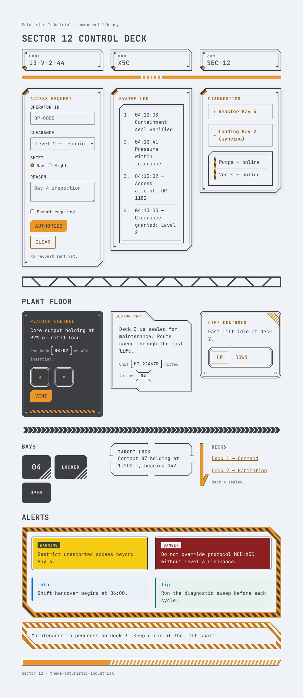

# @tkottke90/theme-futuristic-industrial

A stencilled industrial console theme, built as framework-agnostic Web
Components with [Lit](https://lit.dev). A light blue-grey page, charcoal
"stencil ink", one hazard orange and caution yellow for warnings; panels are
plates with 45° corner cuts, rivets and hazard tape, all set in a monospace
face. Every frame, band and label is traced from a specific element of a sheet
of hazard-tag graphics and drawn to the element's measured size.



> The screenshot is generated: run `npm run screenshot` after
> `npm run build-storybook`. It shows the package's `Demo` story.

## Usage

```
npm install @tkottke90/theme-futuristic-industrial lit
```

```js
import "@tkottke90/theme-futuristic-industrial";
```

```html
<theme-card heading="Status">
  <theme-plate label="Code" value="13-V-2-44"></theme-plate>
  <theme-text>Containment seal verified.</theme-text>
</theme-card>
<theme-button label="Authorize"></theme-button>
```

`lit` is a peer dependency so every theme package in this repo shares a
single copy of it.

To style your own elements with the theme's colours and fonts, load the design
tokens on your page:

```js
import "@tkottke90/theme-futuristic-industrial/tokens.css";
```

**For AI agents and anyone extending the theme:** [`AGENTS.md`](./AGENTS.md)
(shipped with the package) has the style guide, measured contrast, and usage
for vanilla and Preact projects.

## Fonts

The theme is set in **JetBrains Mono**, which the package doesn't load. Add it
to your page head:

```html
<link rel="preconnect" href="https://fonts.googleapis.com" />
<link rel="preconnect" href="https://fonts.gstatic.com" crossorigin />
<link
  href="https://fonts.googleapis.com/css2?family=JetBrains+Mono:wght@400;500;600;700&display=swap"
  rel="stylesheet"
/>
```

Without it, text falls back to IBM Plex Mono if installed, then the system
monospace. The components are designed for a light page:
`background: var(--color-neutral-50)` (`#eff2f7`).

## Components

`theme-button`, `theme-input`, `theme-textarea`, `theme-select`,
`theme-card`, `theme-heading`, `theme-text`, `theme-link`, `theme-container`,
`theme-item`, `theme-field`, `theme-detail`, `theme-blockquote` (10 types),
`theme-skeleton-heading`, and `theme-skeleton-text`.

This theme's extras:

| Element                    | What it is                                                       | Attributes                        |
| -------------------------- | ---------------------------------------------------------------- | --------------------------------- |
| `theme-plate`              | ID/code readout, like the sheet's "CODE-13-V-2-44" tag           | `label`, `value`                  |
| `theme-hazard-container`   | Container framed in hazard tape, for restricted areas            | `as`, `variant` (`dark`, `light`) |
| `theme-casing`             | The dark surface; slotted text switches to light colours         | `heading`                         |
| `theme-tab-panel`          | Thin-ruled panel with its heading in a raised tab                | `heading`                         |
| `theme-conduit-panel`      | Double-ruled panel with a striped corner channel and screw holes | `heading`                         |
| `theme-registration-frame` | Corner brackets with registration ticks, for media               | —                                 |
| `theme-tile`               | Dark tile for an icon, status or number, with a hatched corner   | `plain`                           |
| `theme-well`               | Recessed double-ruled frame for icon buttons or a control group  | —                                 |
| `theme-bracket-rail`       | Outlined orange rail down the left of a sidebar or callout       | —                                 |
| `theme-girder`             | Truss band                                                       | height via CSS                    |
| `theme-segmented-rule`     | Bars-and-slots divider                                           | `orientation`, `size`, `segments` |
| `theme-chevron-rule`       | Chevron divider                                                  | `direction`, `size`               |
| `theme-stripe-band`        | Solid orange block breaking into stripes                         | `size`, `solid`                   |
| `theme-bracket-tag`        | Inline code/ID label in square brackets or flared rules          | `variant` (`square`, `flared`)    |

In a `theme-container`, `as="ol"` numbers the rows and `as="ul"` uses each
row's hazard-stripe tab as its bullet. The warning and danger
`theme-blockquote`s use the sheet's warning-tag treatment: a solid plate, an
outline separated from it by a hairline, and the label in its own strip.

### Forms

`theme-input`, `theme-select` and `theme-textarea` are form-associated custom
elements: inside a `<form>` they submit under their `name`, reset with the
form, follow `<fieldset disabled>`, and fire `change` from the host. They're
labelable, so both `<label for="id">` and a wrapping `<label>` work, including
toggling a checkbox or radio by clicking the label text. Radios with the same
`name` form a group. `theme-button` with `type="submit"` or `type="reset"`
acts on its form.

Each control passes its accessible name to the native element inside it, so
screen readers announce the label: from `aria-label` on the element, or from
its `<label>`. `theme-field` names the control it wraps with its own label
(unless the control already has a name), focuses it when the label is clicked,
and stretches a text control to its width. Wrapping radios, it labels their
group instead: put the radios in an element (a `<div>`) and the field names
that element as a `radiogroup`, so each radio keeps its own label.

```html
<form>
  <theme-field label="Operator ID">
    <theme-input name="operator" placeholder="OP-0000"></theme-input>
  </theme-field>
  <label><theme-input type="checkbox" name="escort" value="yes"></theme-input> Escort</label>
  <theme-button type="submit" label="Authorize"></theme-button>
  <theme-button variant="ghost" label="▲" aria-label="Raise rods"></theme-button>
</form>
```

This behaviour comes from the shared `FormControlElement`, `FieldElement` and
`FormButtonElement` base classes (see `docs/adr/0002-shared-wc-core.md`).

### Dark surfaces

`theme-casing` and `theme-tile` are charcoal. Theme text, headings, links,
list items, field labels and secondary/ghost buttons slotted inside them switch
to light, contrast-checked colours. Light panels placed inside (a Card, a
Detail, a Blockquote) keep their own dark-on-light text. To make a dark area of
your own, see "Using the tokens" in [`AGENTS.md`](./AGENTS.md).

### Resizable frames

Every frame (plates, hazard tape, casing, tab panel, conduit, registration
frame, tile, well, rail) and every band is SVG computed from the element's
measured size and redrawn when it changes, so the cuts, rivets and stripes stay
in place in any layout. Each shape's geometry is a pure, unit-tested module
(`src/*-geometry.ts`).

## Local development

```
npm run generate         # src/generated/: compiled theme styles + shared WC base classes
npm run build            # esbuild -> dist/{index.mjs,index.cjs,*.d.ts,tokens.css}
npm test                 # jest + jsdom
npm run storybook        # preview components
npm run build-storybook  # static Storybook, used by the screenshot
npm run screenshot       # regenerate docs/screenshot.png
```

Tokens live in `themes/futuristic-industrial/theme.css`; component styles are
compiled from them, never hand-copied.
