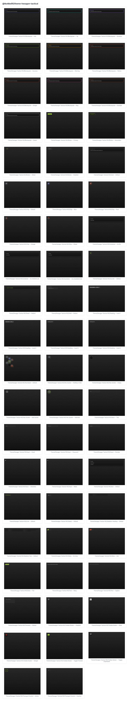

# @tkottke90/theme-hexagon-tactical

A Web Component theme (Lit) that looks like a tactical control panel: dark
carbon-fibre surfaces, plates with 45° cut corners, chunky keys that press
down onto a hard ledge, a lime-green accent for anything active, and red for
alerts. It also ships the pieces of a hex-grid node board (sockets, tiles,
toolbar, transport, meters).



> The screenshot is generated: run `npm run screenshot` after
> `npm run build-storybook`. The `Demo` story comes first, then each
> component's intro and its stories.

## Usage

```
npm install @tkottke90/theme-hexagon-tactical lit
```

```js
import "@tkottke90/theme-hexagon-tactical";
```

```html
<theme-card heading="Board A-7">
  <theme-text>Seat tiles in the board, then run the program.</theme-text>
</theme-card>
<theme-button label="Run program"></theme-button>
```

`lit` is a peer dependency so every theme package in this repo shares a
single copy of it.

To style your own elements with the theme's colours and fonts, load the design
tokens on your page:

```js
import "@tkottke90/theme-hexagon-tactical/tokens.css";
```

**For AI agents and anyone extending the theme:** [`AGENTS.md`](./AGENTS.md)
(shipped with the package) has the full style guide and usage for vanilla and
Preact projects.

### Fonts

The theme uses [Chakra Petch](https://fonts.google.com/specimen/Chakra+Petch)
for everything. Add it to your page head; without it the stack falls back to
Rajdhani (if installed) and then system fonts:

```html
<link rel="preconnect" href="https://fonts.googleapis.com" />
<link rel="preconnect" href="https://fonts.gstatic.com" crossorigin />
<link
  href="https://fonts.googleapis.com/css2?family=Chakra+Petch:wght@400;500;600;700&display=swap"
  rel="stylesheet"
/>
```

The components are designed for a dark page (`--color-bg`, `#0d0d0d`),
ideally with the carbon-fibre weave from `--background-image-carbon` (see
`AGENTS.md`).

## Components

The standard set: `theme-button`, `theme-input`, `theme-textarea`,
`theme-select`, `theme-card`, `theme-heading`, `theme-text`, `theme-link`,
`theme-container`, `theme-item`, `theme-field`, `theme-detail`,
`theme-blockquote` (10 types), `theme-skeleton-heading`, and
`theme-skeleton-text`.

Theme-specific extras, for building a hex-grid node board:

| Element                   | What it is                                                                                                                                          |
| ------------------------- | --------------------------------------------------------------------------------------------------------------------------------------------------- |
| `theme-hex-board`         | Flat-topped hex grid that positions the sockets inside it. `cols`, `rows`, `w` (hex width in px)                                                    |
| `theme-hex-socket`        | One hex cell, a button. `q`, `r` (axial position), `empty`, `add`, `selected`, `step` (run-order number); name it with `aria-label`                 |
| `theme-chip`              | Round tile to seat in a socket. `variant` (`default`, `blue`, `rust`, `charge`, `wheel`), `charge` (0–1), `nub`, `rotation` (degrees); CSS `--size` |
| `theme-toolbar-button`    | Square icon key. `material` (`graphite`, `steel`, `danger`, `toggle`), `pressed` (toggle only), `label` (accessible name)                           |
| `theme-transport-control` | Play/stop style key. `pressed`, `label` (accessible name)                                                                                           |
| `theme-counter`           | Large lime readout in corner brackets. `value`, `label` (fuller reading for screen readers)                                                         |
| `theme-slots`             | Segmented meter of skewed bars. `total`, `on` (lit lime), `hot` (lit red, after the lime ones), `label`                                             |

`theme-toolbar-button` and `theme-transport-control` don't toggle themselves:
set `pressed` from your click handler.

### Forms

`theme-input`, `theme-select` and `theme-textarea` are form-associated custom
elements: inside a `<form>` they submit under their `name`, reset with the
form, follow `<fieldset disabled>`, and fire `change` from the host. They're
labelable, so both `<label for="id">` and a wrapping `<label>` work, including
toggling a checkbox or radio by clicking the label text. Radios with the same
`name` form a group.

Each control passes its accessible name to the native element inside it, so
screen readers announce the label: from `aria-label` on the element, or from
its `<label>`. `theme-field` names the control it wraps with its own label
(unless the control already has a name) and focuses it when the label is
clicked.

```html
<form>
  <theme-field label="Callsign">
    <theme-input name="callsign"></theme-input>
  </theme-field>
  <label><theme-input type="checkbox" name="silent" value="yes"></theme-input> Radio silence</label>
  <theme-select name="squad" aria-label="Squad"
    ><option>Vanguard</option>
    <option>Recon</option></theme-select
  >
</form>
```

**Migrating:** the form controls no longer read an `accessible-label`
attribute; use `aria-label` instead (or a `<label>`, or `theme-field`).
`theme-button` keeps `accessible-label` for now.

## Local development

```
npm run generate         # src/generated/: compiled theme styles + shared WC base classes
npm run build            # esbuild -> dist/{index.mjs,index.cjs,*.d.ts,tokens.css}
npm test                 # jest + jsdom
npm run storybook        # preview components
npm run build-storybook  # static Storybook, used by the screenshot
npm run screenshot       # regenerate docs/screenshot.png
```

Tokens live in `themes/hexagon-tactical/theme.css`; component styles are
compiled from them, never hand-copied.
