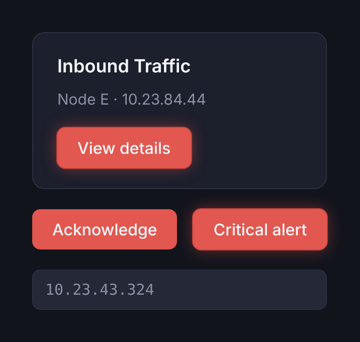
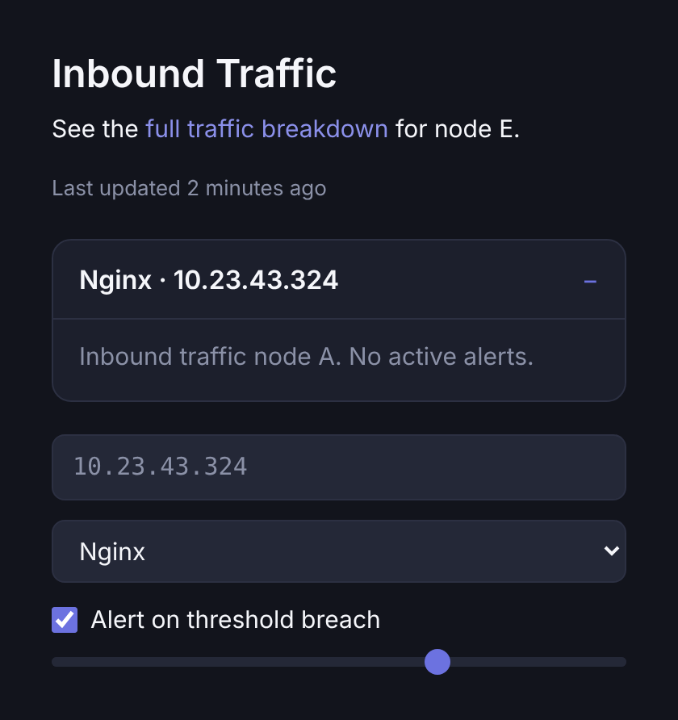

# @tkottke90/theme-network-ops

Dark, monitoring-dashboard theme authored with Tailwind v4's CSS-first
`@theme` directive and built to a single self-contained stylesheet.
Tokens are modeled on a network-topology/infra monitoring dashboard design:
a near-black surface, coral/red accent for alert states, and an indigo
accent for secondary data.



## Usage

```
npm install @tkottke90/theme-network-ops
```

```js
import "@tkottke90/theme-network-ops";
```

or link `dist/index.css` directly in an HTML `<link>` tag.

## Components

- `.theme-card` / `.theme-card__title` / `.theme-card__body`
- `.theme-button` (add `.theme-button--glow` for an alert/critical state)
- `.theme-input` — text inputs; combine with a modifier for other field types:
  - `.theme-textarea`, `.theme-select` (use alongside `.theme-input` for the
    shared box styling, e.g. `class="theme-input theme-textarea"`)
  - `.theme-checkbox`, `.theme-radio`, `.theme-range` (standalone, native
    `accent-color` theming)
  - `.theme-field-label` wraps a checkbox/radio and its label text
- `.theme-details` / `.theme-details__body` — a themed `<details>`/`<summary>`
  disclosure
- Typography is applied directly to elements, not classes: `h1`–`h6`, `p`,
  `a`, `small`, `code`/`pre`/`kbd`



## Local development

```
npm run build              # compiles src/index.css -> dist/index.css
npm run storybook          # preview the theme's component classes
```
