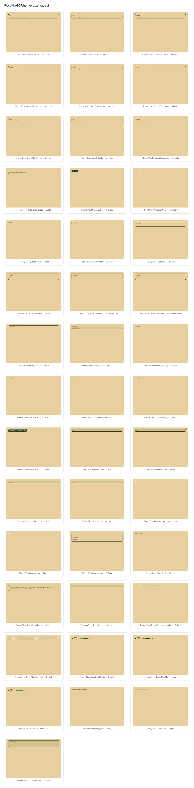

# @tkottke90/theme-pixel-quest

Pixel-art RPG stat-sheet theme built as framework-agnostic Web Components
with [Lit](https://lit.dev). Parchment background, pixel-stepped rounded
corners, and a dark-green/gold palette lifted from a pixel-art poster.

Covers CONTRIBUTING.md's full minimum component set (Button, Input, Card,
Typography, Link, Container, Item, Field, Detail, Blockquote, Skeleton),
plus bonus components: `theme-stat-meter` (the source image's repeated
stat-bar widget) and `theme-page-frame` (the source's own whole-page
border).



## Usage

```
npm install @tkottke90/theme-pixel-quest lit
```

```js
import "@tkottke90/theme-pixel-quest";
```

```html
<theme-button label="Save"></theme-button> <theme-card heading="Hello">Body content</theme-card>
```

`lit` is a peer dependency so every theme package in this repo shares a
single copy of it.

## Local development

```
npm run build        # esbuild -> dist/{index.mjs,index.cjs,index.d.ts}
npm test             # jest + jsdom
npm run storybook    # preview components
```
