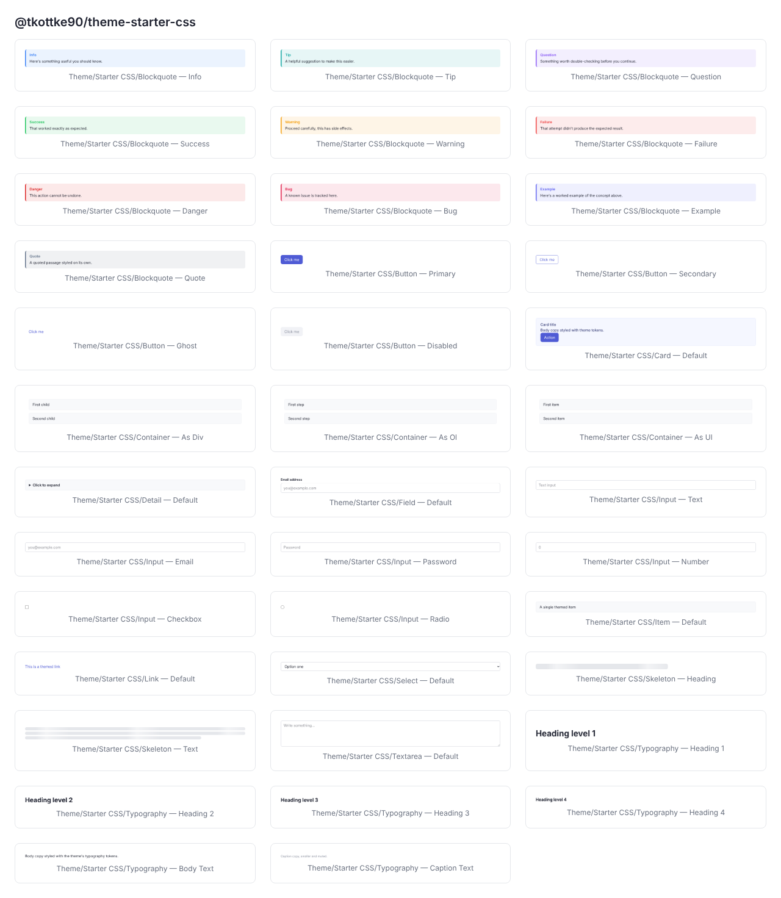

# @tkottke90/theme-starter-css

Starter / reference template for a plain CSS theme: a handful of
hand-written component classes (`.theme-button`, `.theme-card`,
`.theme-input`, …) authored with Tailwind v4's CSS-first `@theme` directive
and built to a single self-contained stylesheet. No JavaScript ships.

> **Copying this starter?** Replace this paragraph with one that describes
> your theme's look in a sentence or two (its materials, colours and mood),
> rename the package everywhere it appears in this file, and regenerate the
> screenshot below with `npm run screenshot`. Then delete this note.



## Usage

```
npm install @tkottke90/theme-starter-css
```

```js
import "@tkottke90/theme-starter-css";
```

or link `dist/index.css` directly in an HTML `<link>` tag. Then use the
classes on ordinary HTML:

```html
<div class="theme-card">
  <h2 class="theme-heading theme-heading--h3">Card title</h2>
  <p class="theme-text">Body copy styled with theme tokens.</p>
  <button class="theme-button">Action</button>
</div>
```

The stylesheet also defines every design token as a CSS custom property
(`--color-brand-500`, `--font-sans`, `--radius-theme`, …), so you can style
your own elements to match.

**For AI agents and anyone extending the theme:** [`AGENTS.md`](./AGENTS.md)
(shipped with the package) has the style guide and usage notes.

> **Copying this starter?** List anything else a consumer must add here, for
> example a font `<link>` or the page background the theme is designed for.

## Components

Every class is plain CSS on native elements:

| Class                                             | Use on                                 | Modifiers                                                                                                                                                  |
| ------------------------------------------------- | -------------------------------------- | ---------------------------------------------------------------------------------------------------------------------------------------------------------- |
| `.theme-button`                                   | `<button>`                             | `--secondary`, `--ghost`; `disabled`                                                                                                                       |
| `.theme-card`                                     | any block                              |                                                                                                                                                            |
| `.theme-container`                                | `<div>`, `<ol>`, `<ul>`                |                                                                                                                                                            |
| `.theme-item`                                     | `<div>`, `<li>`                        |                                                                                                                                                            |
| `.theme-detail`                                   | `<details>`                            |                                                                                                                                                            |
| `.theme-blockquote`                               | `<blockquote>`                         | `--info`, `--tip`, `--question`, `--success`, `--warning`, `--failure`, `--danger`, `--bug`, `--example`, `--quote`; label with `.theme-blockquote__label` |
| `.theme-heading`                                  | `<h1>`–`<h4>`                          | `--h1`, `--h2`, `--h3`, `--h4`                                                                                                                             |
| `.theme-text`                                     | `<p>`, `<span>`                        | `--caption`                                                                                                                                                |
| `.theme-link`                                     | `<a>`                                  |                                                                                                                                                            |
| `.theme-field`                                    | `<div>` or `<fieldset>`                | `.theme-field__option` for a `<label>` wrapping a checkbox or radio                                                                                        |
| `.theme-input`                                    | `<input>` (text-like, checkbox, radio) |                                                                                                                                                            |
| `.theme-select`                                   | `<select>`                             |                                                                                                                                                            |
| `.theme-textarea`                                 | `<textarea>`                           |                                                                                                                                                            |
| `.theme-skeleton-heading`, `.theme-skeleton-text` | empty `<div>`                          |                                                                                                                                                            |

> **Copying this starter?** Keep this table in step with `src/index.css`,
> and add any classes that are specific to your theme below it.

### Forms

The form classes style native controls, so everything a browser form does
keeps working: controls submit under their `name`, reset with the form, and
follow `<fieldset disabled>`. Label a control with `<label for>` and a
matching `id`, or wrap it in the `<label>`. Checkboxes and radios that share a
`name` form a group; put them in a `<fieldset class="theme-field">` with a
`<legend>`.

States are styled from the native pseudo-classes: `:focus-visible` (brand
ring), `:disabled` (neutral greys), `:checked` (brand `accent-color`), and
invalid (`:user-invalid`, so fields only turn red after the user has
interacted, or `aria-invalid="true"` to set it yourself).

```html
<form>
  <div class="theme-field">
    <label for="email">Email address</label>
    <input class="theme-input" type="email" id="email" name="email" required />
  </div>
  <fieldset class="theme-field">
    <legend>Plan</legend>
    <label class="theme-field__option">
      <input class="theme-input" type="radio" name="plan" value="free" checked /> Free
    </label>
    <label class="theme-field__option">
      <input class="theme-input" type="radio" name="plan" value="pro" /> Pro
    </label>
  </fieldset>
  <button class="theme-button" type="submit">Save</button>
</form>
```

## Local development

```
npm run build              # compiles src/index.css -> dist/index.css
npm run storybook          # preview the theme's component classes
npm run screenshot         # regenerate docs/screenshot.png (after build-storybook)
```

Tokens live in `themes/theme-starter/theme.css`; `src/index.css` imports
them. Every stories file sets `parameters.intro` (shown above its stories and
in the screenshot), and `stories/Demo.stories.ts` is a full page built from
the classes.
