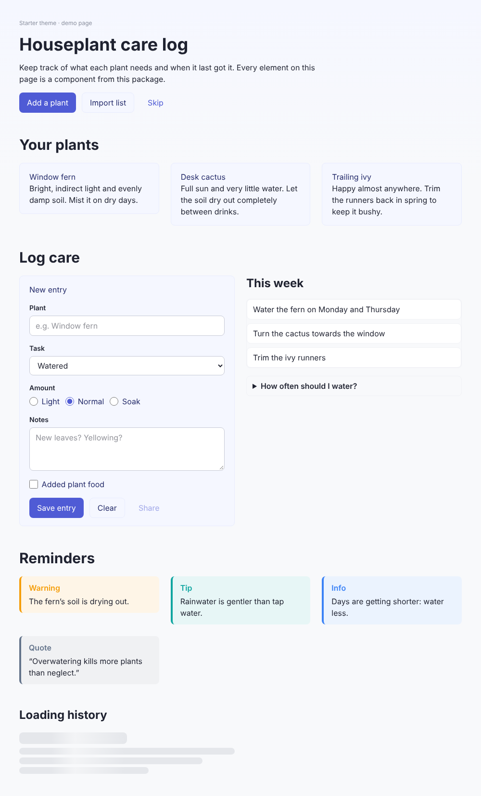

# @tkottke90/theme-starter-react

Starter / reference template for a component-library theme built with
[Preact](https://preactjs.com) (React-API compatible). The components are
deliberately plain: a light page, one brand colour and a shared corner radius,
so the structure is easy to see and copy.

> **Copying the starter?** Replace this paragraph with one or two sentences on
> your theme's look (its materials, colours and type), rename the package
> everywhere `theme-starter-react` appears, and regenerate the screenshot below
> with `npm run screenshot`. Each section that needs rewriting has a note like
> this one; delete the notes when you're done.



## Usage

```
npm install @tkottke90/theme-starter-react preact
```

```tsx
import { ThemeButton, ThemeCard, ThemeText } from "@tkottke90/theme-starter-react";
import "@tkottke90/theme-starter-react/theme.css";

export function Welcome() {
  return (
    <ThemeCard heading="Welcome">
      <ThemeText>Every component is styled by the theme stylesheet.</ThemeText>
      <ThemeButton label="Get started" />
    </ThemeCard>
  );
}
```

`preact` is a peer dependency so every component theme package in this repo
shares a single copy of it. React projects can use the package through
`preact/compat` (alias `react` and `react-dom` to it in your bundler).

`theme.css` is required: it holds the compiled component styles and the
theme's design tokens as CSS custom properties, which you can use to style
your own elements (`var(--color-brand-500)`, `var(--font-sans)`).

**For AI agents and anyone extending the theme:** [`AGENTS.md`](./AGENTS.md)
(shipped with the package) has the style guide and usage for Preact and
React-compat projects.

> **Copying the starter?** If your theme needs web fonts or a particular page
> background, say so here, with the `<link>` tags to add.

## Components

`ThemeButton`, `ThemeInput`, `ThemeTextarea`, `ThemeSelect`, `ThemeCard`,
`ThemeHeading`, `ThemeText`, `ThemeLink`, `ThemeContainer`, `ThemeItem`,
`ThemeField`, `ThemeDetail`, `ThemeBlockquote` (10 types),
`ThemeSkeletonHeading`, and `ThemeSkeletonText`.

> **Copying the starter?** Keep this standard set. List any theme-specific
> extras in a table here (component, what it is, its props).

### Forms

`ThemeInput`, `ThemeSelect` and `ThemeTextarea` render native form controls
and forward every native prop (`name`, `id`, `value` / `defaultValue`,
`checked` / `defaultChecked`, `disabled`, `required`, `onInput`, `onChange`,
`aria-*`, ...). So inside a `<form>` they submit under their `name`, reset with
the form, follow `<fieldset disabled>`, and work both controlled (`value` plus
`onInput`) and uncontrolled (`defaultValue`). `ThemeButton` takes
`type="submit"` or `type="reset"`.

`ThemeField` labels its control natively with `<label for>`: it uses the
control's `id`, or gives it a generated one. Clicking the label focuses the
control, and the label is its accessible name. Wrapping several controls (such
as a radio group), it labels them as a group.

```tsx
<form onSubmit={(e) => console.log(new FormData(e.currentTarget))}>
  <ThemeField label="Name">
    <ThemeInput name="name" defaultValue="Ada" required />
  </ThemeField>
  <ThemeField label="Plan">
    <ThemeSelect name="plan" defaultValue="pro">
      <option value="free">Free</option>
      <option value="pro">Pro</option>
    </ThemeSelect>
  </ThemeField>
  <label>
    <ThemeInput type="checkbox" name="updates" value="yes" /> Send me updates
  </label>
  <ThemeButton type="submit" label="Sign up" />
</form>
```

This package imports `preact/compat` (for `forwardRef`, so a `ref` reaches each
control's native element). Importing compat installs it for the whole app: text
inputs' `onChange` then fires on every keystroke, as in React, everywhere in
your Preact tree, not just in these components. `onInput` works either way.

> **Copying the starter?** Keep this behaviour (the tests in
> `src/form-control.test.tsx` cover it); only restyle the controls.

## Local development

```
npm run build             # esbuild -> dist/{index.mjs,index.cjs,index.d.ts} + dist/theme.css
npm test                  # jest + jsdom + @testing-library/preact
npm run storybook         # preview components
npm run build-storybook   # static Storybook, used by the screenshot
npm run screenshot        # regenerate docs/screenshot.png
```

Tokens live in `themes/theme-starter/theme.css` and are compiled into
`dist/theme.css` by `scripts/build.mjs`; don't copy token values into the
components. Each stories file sets `parameters.intro` (shown above its
stories), and `src/Demo.stories.tsx` is the full-page demo the screenshot
shows.
