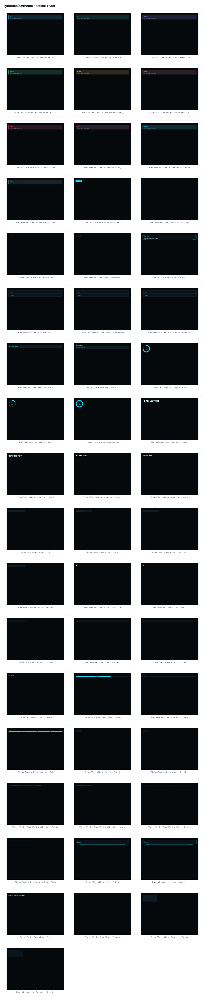

# @tkottke90/theme-tactical-react

Dark/light HUD-inspired component theme, built with
[Preact](https://preactjs.com) (React-API compatible). Cyan glow accents,
notched SVG panel frames, and a data-display set (stat readout, segmented
progress bar, radial gauge) on top of the repo's baseline component set.
Swap `preact` for `react` in this package's own dependencies if you
specifically need React instead of Preact.



## Usage

```
npm install @tkottke90/theme-tactical-react preact
```

```tsx
import { ThemeCard, ThemeStat, ThemeProgress, ThemeGauge } from "@tkottke90/theme-tactical-react";
import "@tkottke90/theme-tactical-react/theme.css";
```

`preact` is a peer dependency so every component theme package in this repo
shares a single copy of it. The compiled stylesheet is a separate export
(`./theme.css`) — import it once, globally, rather than per component.

## Light / dark mode

The theme is dark by default (matching the source HUD design), and follows
the OS/browser `prefers-color-scheme` setting automatically whenever nothing
overrides it. To override that explicitly, set `data-theme="light"` or
`data-theme="dark"` on **any ancestor element** (`<html>`, an app wrapper
`<div>`, or an individual component) — it's a plain CSS custom property
override, so it cascades normally to everything inside. Storybook's
"Theme" toolbar toggle (top of the preview) demonstrates this.

## Local development

```
npm run build        # esbuild -> dist/{index.mjs,index.cjs,index.d.ts}; tailwind -> dist/theme.css
npm test             # jest + jsdom + @testing-library/preact
npm run storybook    # preview components
```
