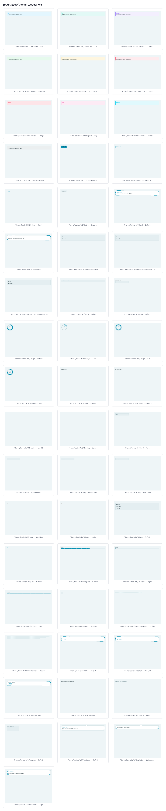

# @tkottke90/theme-tactical-wc

Dark/light HUD-inspired component theme, built as framework-agnostic Web
Components with [Lit](https://lit.dev). Cyan glow accents, resizable SVG
panel frames (a tab-and-chevron style on Card/Stat, a rounded
uneven-corner-plus-bracket style on Viewfinder), and a data-display set
(stat readout, segmented progress bar, radial gauge) on top of the repo's
baseline component set.



## Usage

```
npm install @tkottke90/theme-tactical-wc lit
```

```js
import "@tkottke90/theme-tactical-wc";
```

```html
<theme-card heading="Status">
  <theme-stat label="System Status" value="1565"></theme-stat>
  <theme-progress label="Signal" value="65"></theme-progress>
  <theme-gauge label="Power" value="72"></theme-gauge>
</theme-card>

<theme-viewfinder heading="Target lock">Locked on contact 07.</theme-viewfinder>
```

`lit` is a peer dependency so every theme package in this repo shares a
single copy of it.

## Light / dark mode

The theme is dark by default (matching the source HUD design), and follows
the OS/browser `prefers-color-scheme` setting automatically whenever nothing
overrides it. To override that explicitly, set `data-theme="light"` or
`data-theme="dark"` **directly on each `theme-*` element** you want to
override, e.g. `<theme-card data-theme="light">` — see the "Light" stories
on Card/Stat/Gauge/Viewfinder in Storybook for a live example.

This per-element requirement (rather than one attribute on `<html>`) is a
Shadow DOM constraint, not a choice: a `data-theme` attribute set on an
ancestor outside a component's shadow tree does not cascade into that shadow
tree, confirmed empirically against this package's build. The React variant
of this theme (`@tkottke90/theme-tactical-react`) doesn't have this
limitation — there, `data-theme` can be set once on any ancestor (including
`<html>`) and it cascades normally.

## Local development

```
npm run build        # esbuild -> dist/{index.mjs,index.cjs,index.d.ts}
npm test             # jest + jsdom
npm run storybook    # preview components
```
