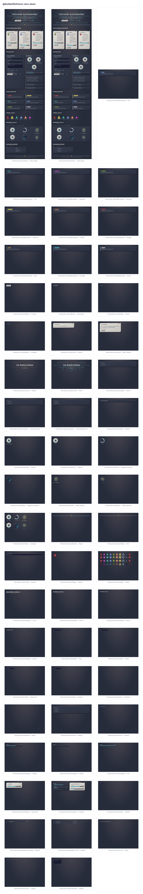

# @tkottke90/theme-zero-dawn

A Web Component theme (Lit) built around a post-apocalyptic "machine and
tribe" look: light, faceted armour plates sitting on dark machine cores,
thin cyan seams, amber wiring, and hand-painted tribal glyphs. Nearly every
surface is drawn in SVG.



## Usage

```
npm install @tkottke90/theme-zero-dawn lit
```

```js
import "@tkottke90/theme-zero-dawn";
```

```html
<theme-card heading="Field notes">
  <theme-text>Plates overlap like scales; the core shows through every seam.</theme-text>
</theme-card>
<theme-glyph name="spear" color="red" shape="shield" label="Hunters"></theme-glyph>
```

`lit` is a peer dependency so every theme package in this repo shares a
single copy of it.

To style your own elements with the theme's colours and fonts, load the design
tokens on your page:

```js
import "@tkottke90/theme-zero-dawn/tokens.css";
```

**For AI agents and anyone extending the theme:** [`AGENTS.md`](./AGENTS.md)
(shipped with the package) has the full style guide and usage for vanilla and
Preact projects.

### Fonts

The theme uses [Saira](https://fonts.google.com/specimen/Saira) (display/UI)
and [Crimson Pro](https://fonts.google.com/specimen/Crimson+Pro) (body).
Add these to your page head; the stacks fall back to system fonts without them:

```html
<link rel="preconnect" href="https://fonts.googleapis.com" />
<link rel="preconnect" href="https://fonts.gstatic.com" crossorigin />
<link
  href="https://fonts.googleapis.com/css2?family=Saira:wght@400;500;600;700&family=Crimson+Pro:ital,wght@0,400;0,600;1,400&display=swap"
  rel="stylesheet"
/>
```

The components are designed for a dark page (`--color-bg`, `#262b3a`).

## Components

The standard set: `theme-button`, `theme-input`, `theme-textarea`,
`theme-select`, `theme-card`, `theme-heading`, `theme-text`, `theme-link`,
`theme-container`, `theme-item`, `theme-field`, `theme-detail`,
`theme-blockquote` (10 types), `theme-skeleton-heading`, and
`theme-skeleton-text`.

Theme-specific extras:

| Element          | What it is                                                                                                                                                                               |
| ---------------- | ---------------------------------------------------------------------------------------------------------------------------------------------------------------------------------------- |
| `theme-glyph`    | Hand-painted emblem. `name` (10 original glyphs), `color` (tribal paints), `shape`, `size`, `label`                                                                                      |
| `theme-divider`  | Woven band rule: `variant="peaks"` (sawtooth) or `"trim"` (zigzag and beads)                                                                                                             |
| `theme-disc`     | Radial progress: a meter with `value`, a spinner without. `variant` is `dish`, `segments` or `peaks`; only the light moves                                                               |
| `theme-circuit`  | Symmetric circuit-trace backdrop for heroes and empty states; `glow` lights the traces                                                                                                   |
| `theme-progress` | Progress bar: a glowing cyan channel. `variant="raised"` (steel plate, for dark containers) or `"recessed"` (cut into the surface, for light cards); `value`, `max`, `segments`, `label` |

### Progress colour

`theme-progress` takes its colour from `--zd-progress-fill`, which defaults to
the theme's machine cyan. Set it to **any colour** on a bar (or an ancestor) to
recolour the fill, its glow, the leading edge and the recessed variant's wall
tint:

```html
<theme-progress value="35" style="--zd-progress-fill: #84212b"></theme-progress>
```

Only the colour's hue is used. Lightness and chroma are locked (OKLCH 0.72 /
0.12, the band the theme cyan sits in), so every hue holds 7.3–8.1:1 contrast
against the empty channel and stays displayable. The flip side: deep or vivid
colours are evened out (a dark red becomes a coral), and greys, which have no
hue, come out a muted red. This uses CSS relative colour syntax (Chrome 119+,
Firefox 128+, Safari 18+); older browsers use the colour exactly as given.

### Forms

`theme-input`, `theme-select` and `theme-textarea` are form-associated custom
elements: inside a `<form>` they submit under their `name`, reset with the
form, follow `<fieldset disabled>`, and fire `change` from the host. They're
labelable, so both `<label for="id">` and a wrapping `<label>` work, including
toggling a checkbox or radio by clicking the label text. Radios with the same
`name` form a group.

Each control passes its accessible name to the native element inside it, so
screen readers announce the label: from `aria-label` on the element, or from
its `<label>`. `theme-field` names the control it wraps with its own label
(unless the control already has a name) and focuses it when the label is
clicked. Wrapping radios, it labels their group instead: put the radios in an
element (a `<div>`) and the field names that element as a `radiogroup`, so
each radio keeps its own label.

```html
<form>
  <label>Machine <theme-input name="machine"></theme-input></label>
  <label><theme-input type="checkbox" name="core" value="yes"></theme-input> Core exposed</label>
  <theme-select name="class"
    ><option>Grazer</option>
    <option>Hunter</option></theme-select
  >
</form>
```

### Surfaces and ink

A light `theme-card` sets dark ink for its slotted content, and steel surfaces
(Container, Detail, Blockquote) set light ink. They do this through the
`--zd-ink`, `--zd-ink-muted`, `--zd-link` and `--zd-accent` custom properties,
so `theme-text`, `theme-link` and the other components keep AA contrast on
either surface without extra attributes.

## Local development

```
npm run build        # esbuild -> dist/{index.mjs,index.cjs,index.d.ts}
npm test             # jest + jsdom
npm run storybook    # preview components
```

Tokens live in `themes/zero-dawn/theme.css`.
